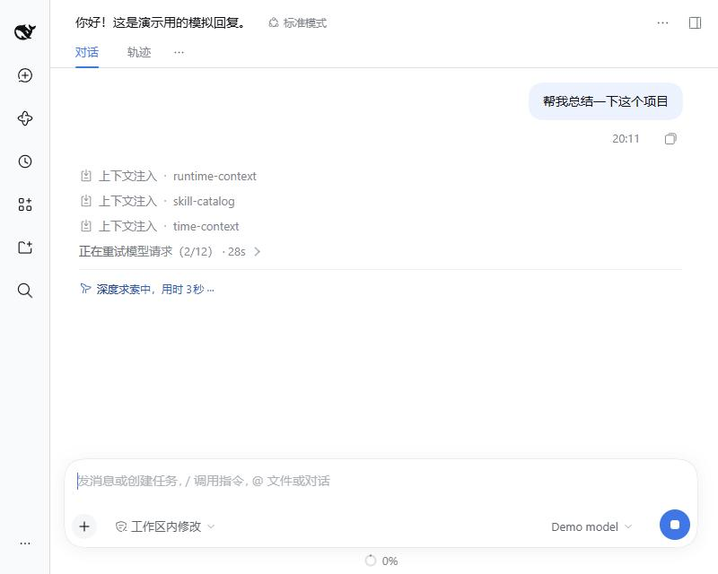
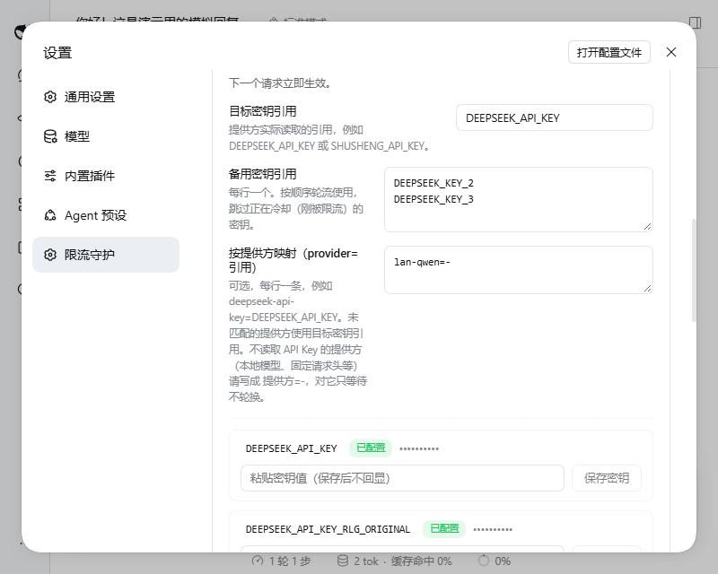
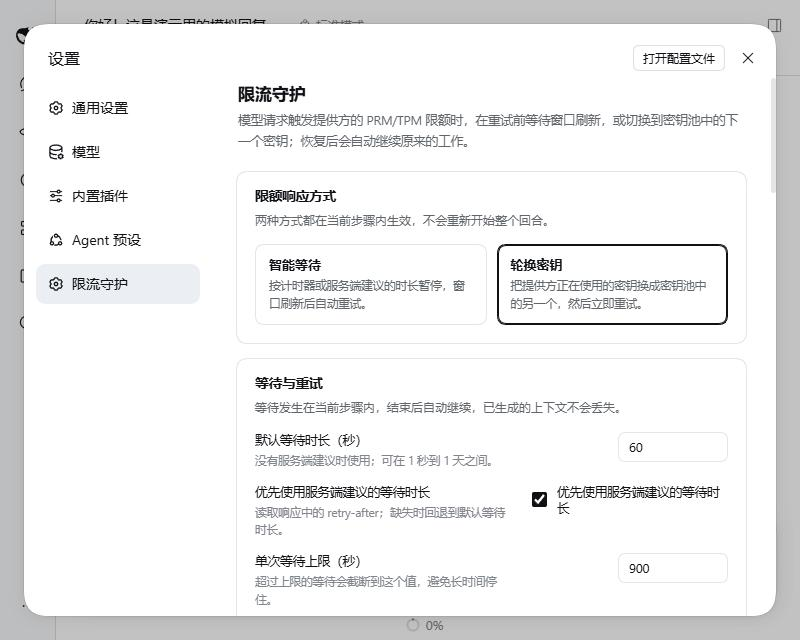
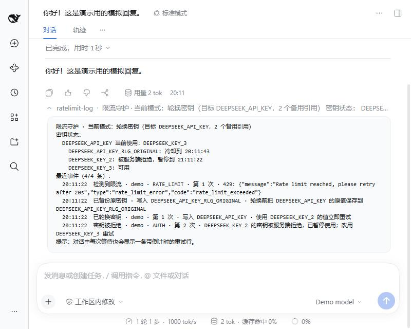

# dsh-rate-limit-guard

[](https://github.com/ChuQing-debug/dsh-rate-limit-guard/actions/workflows/test.yml)


[](LICENSE)

[中文](README.md) | English

A plugin for DeepSeek Harness (DSH). When a model request is rate limited (429), the current step either **waits and resumes on its own** or **switches to another API key and carries on**. The task is not interrupted and no context is lost.



The screenshots show the Chinese UI; the settings page is available in English too.

## What it solves

When an agent hits a rate limit mid-task, DSH retries a few times and then fails the turn, and you have to send the message again. With this plugin:

- **Wait mode** (default): waits for as long as the provider says, or for the time you configured, then retries the same step.
- **Rotate mode**: with several keys, switches to the next one and retries at once; when every key is limited, waits for the first one to come back.
- Exhausted balance or quota (`QUOTA` / `ACCOUNT_QUOTA`) is not waited out: rotate mode switches keys, wait mode fails straight away.
- **Unattended continuation**: when the model stops at its output token limit, the plugin can send the continue message for you; with it off, a small prompt above the composer offers to fill the message in.
- Every wait and rotation is recorded; type `/ratelimit-log` in a conversation to see them.

## Quick start

### Install

Requires DSH 0.2.2-rc.3 or a compatible release (verified on desktop). No runtime dependencies and no build step.

1. Clone the repository to a permanent location. DSH usually links to this directory, so do not move or delete it afterwards; even when your setup copies instead of links, keep the clone around for updates.

   ```bash
   git clone https://github.com/ChuQing-debug/dsh-rate-limit-guard.git
   ```

2. In DSH open **Plugin Manager → Install bundle** and choose the cloned directory. From the command line, if your DSH install ships the CLI:

   ```bash
   dsh plugin --profile <profile name> add <absolute path of the clone>
   ```

3. Restart DSH (reload the page for the web client).

Wait mode is active after installation; nothing else is needed.

> Do not edit the profile's `cordis.patch.yml` or `package.json` by hand to install the plugin; DSH manages those files.

### Just wait (default)

No setup. To tune it, open **Settings → Rate limit guard**:

- **Default wait**: how long to wait when the provider gives no hint; 60 seconds by default.
- **Wait cap**: the longest single wait; 900 seconds by default.
- **Total wait per step**: the longest a step may wait in total; 60 minutes by default.

### Several keys, rotate automatically

1. Open **Settings → Rate limit guard** and choose **Rotate key**.
2. Set **Target credential reference** to the reference the provider actually reads, i.e. the `apiKeyEnv` in the provider's configuration, for example `DEEPSEEK_API_KEY`.
3. List one reference per line under **Pool references**, for example `DEEPSEEK_KEY_2`, `DEEPSEEK_KEY_3`.
4. In the key list below, paste the key value for each pool reference and click **Save key**.
5. If you also use a **provider that needs no API key** (local models, endpoints authenticated by a fixed header), add a line `provider-name=-` under **Provider mapping**. See [FAQ](#faq) for why.
6. Click **Save**.



The settings page stores reference names only. Key values go to DSH's credentials service and are never shown again.

## Which mode

| | Wait | Rotate |
| --- | --- | --- |
| Good for | One key, or short limit windows | Several keys, continue immediately |
| On a rate limit | Wait, then retry | Switch to the next key and retry at once |
| Every key limited | n/a | Wait for the first key to come back |
| Balance or quota exhausted | Handed back to DSH as an error | Switch to the next key |
| Setup | None | Fill in the key pool |



## Viewing the record

Type `/ratelimit-log` in a conversation. In rotate mode it lists the state of every key, then the last 20 events:



Only reference names and times are shown, never key values. The plugin log carries the same events, prefixed `rate-limit-guard`.

## Configuration

Every option except `minWaitSeconds` can be changed on the settings page and takes effect on save, without a restart.

### Waiting

| Option | Default | Meaning |
| --- | --- | --- |
| `mode` | `wait` | `wait` or `rotate` |
| `waitSeconds` | `60` | Wait when the provider gives no hint |
| `useRetryAfter` | `true` | Prefer the wait the provider suggests |
| `maxWaitSeconds` | `900` | Cap for a single wait |
| `maxAttempts` | `12` | Retries per step |
| `maxTotalWaitMinutes` | `60` | Total wait per step; `0` means no limit |
| `jitter` | `true` | Add up to 10 % (at most 5 s) to each wait |
| `waitOnQuota` | `false` | Also wait when balance or quota is exhausted |

- **Where the wait comes from**, in order: the provider's `retry-after`, a hint in the error message, `waitSeconds`. Hints are read in English and Chinese, for example `retry after 30s`, `try again in 1m30s`, `请在 30 秒后重试`, `until 2026-11-18T11:11:52Z (~9s`.
- **After a cap is reached** (`maxAttempts` or `maxTotalWaitMinutes`) the failure goes back to DSH's default retry policy, which may still retry a few times on its own.

### Rotation

| Option | Default | Meaning |
| --- | --- | --- |
| `credentialRef` | `DEEPSEEK_API_KEY` | The reference the provider reads; rotation writes to it |
| `alternateKeyRefs` | `[]` | References of the pool keys |
| `providerRefs` | `[]` | `provider=REFERENCE` lines; `provider=-` means never rotate for that provider |
| `keepOriginalKey` | `true` | Back up the original key before rotating away from it |
| `quotaCooldownMinutes` | `60` | How long a key with exhausted quota is skipped |
| `fallbackToWait` | `true` | Wait when no key is usable |

### Other

| Option | Default | Meaning |
| --- | --- | --- |
| `guardedProviders` | `[]` | Guard only these providers; empty means all |
| `language` | `auto` | Language of the log and `/ratelimit-log`: `auto`, `zh`, `en` |
| `minWaitSeconds` | `1` | Floor for waits and cooldowns; configuration file only |

Reference names may contain letters, digits and underscores, and must not start with a digit.

### Unattended mode

| Option | Default | Meaning |
| --- | --- | --- |
| `unattended` | `false` | Send the continue message automatically when the reply is cut off by the output token limit |
| `continueText` | `继续` | The message that is sent |

When a turn ends at the output token cap (`turn/end` with `reason.kind` `max-tokens`), the plugin sends `continueText` to the same session so the model carries on. At most 20 consecutive auto-continues are allowed; any turn that does not end in a truncation, or a gap of 30 minutes, resets the counter, and the cap is logged once.

With the switch off, DSH's own "output token limit reached" notice still appears, and a small bar above the composer offers **Fill continue**, which puts `continueText` in the input and focuses it; the bar can also be dismissed.

## Key safety

Rotation rewrites the key in the target reference, so the plugin follows one rule: **it never overwrites a key that is not stored somewhere else.**

- **The original key is backed up first.** The first time your own key is rotated away, it is saved to `<target>_RLG_ORIGINAL` and stays in the rotation.
- **A key you set later is backed up too.** If you put a new key into the target afterwards, it is saved to `<target>_RLG_PREVIOUS`.
- **Backups are never overwritten.** When both backup slots are taken, the plugin refuses to rotate, waits instead, and says why in the log. Add the new key to the pool, or clear one backup, to resume rotation.
- **Unreadable means untouched.** If the target or a backup cannot be read, or the target changes while a rotation is running, that rotation is abandoned.
- **Dead keys are skipped.** If the key that was just installed is rejected by the provider (401), it is benched for an hour and the next key is used. At most two keys of a reference are benched per ten minutes; beyond that the plugin stops and puts the original key back, so a provider outage cannot bench the whole pool.
- **State is in memory only.** Cooldowns and benches store a fingerprint of the key, never the key, and are cleared when DSH restarts.

To get the original key back: it is in `<target>_RLG_ORIGINAL` and rejoins the rotation by itself; you can also paste it back into the target on the settings page.

With `keepOriginalKey` off there is no backup and rotation overwrites the target directly.

## Known limitations

- **No switching between providers.** A DSH retry reuses the step's provider and model; the plugin changes the key that provider reads.
- **Keyless providers must be marked by hand.** DSH does not tell plugins which reference a provider reads, so only `deepseek-account` is recognised automatically; others need `provider=-` in the mapping.
- **`Retry-After` headers may not arrive.** On DSH 0.2.2-rc.3 the header of an `openai-completions` provider did not reach the plugin, leaving only hints in the error message, or the default wait.
- **No rotation without the credentials service.** A profile that does not load `credentials` cannot read or replace keys, so rotation falls back to waiting and logs the reason.
- **No live status on the settings page.** DSH does not let a third-party plugin feed runtime state to its own settings page; use `/ratelimit-log`.
- **Rotation is global.** The target reference is shared by every session that reads it.
- **Cooldowns are per key, not per model.** A key limited on one model is skipped for other models too, for a while.

## FAQ

| Symptom | Check |
| --- | --- |
| Settings page says the configuration was not found | Is the plugin enabled in this profile? Restart DSH and reopen Settings |
| It failed without waiting | Was the failure a rate limit (`RATE_LIMIT`, 429)? Exhausted balance is not waited out by default. Is the provider missing from `guardedProviders`? |
| No rotation happened | Do all pool references have values? Is the provider marked `-`? Are all keys cooling in `/ratelimit-log`? |
| The log says both backup references are in use | See [Key safety](#key-safety): add the new key to the pool, or clear a backup |
| `/ratelimit-log` is an unknown command | The host half is not loaded; reinstall or re-enable the bundle |
| Save fails | The settings document is read-only or was changed elsewhere; click Reload and save again |

**Why mark keyless providers with `provider=-`?**
Otherwise a rate limit on that provider makes the plugin rotate the default reference. That cannot help the provider, and it needlessly puts pool keys on cooldown.

## Development

No build step and no runtime dependencies.

```bash
npm run check   # syntax check
npm test        # all tests, on node:test, no dependencies
```

- How it works and why: [docs/DESIGN.md](docs/DESIGN.md) (Chinese).
- Version history: [English](CHANGELOG.en.md) · [中文](CHANGELOG.md).
- The in-app help page is [docs/DETAIL.md](docs/DETAIL.md) (Chinese).

## License

[MIT](LICENSE). `schemastery` and `cosmokit` under `vendor/` are MIT licensed as well; see [vendor/NOTICE.md](vendor/NOTICE.md).

For security issues, please do not open a public issue; report them privately as described in [SECURITY.md](SECURITY.md).
