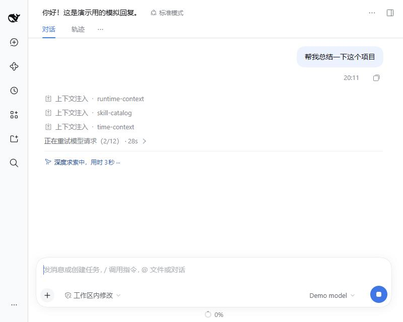
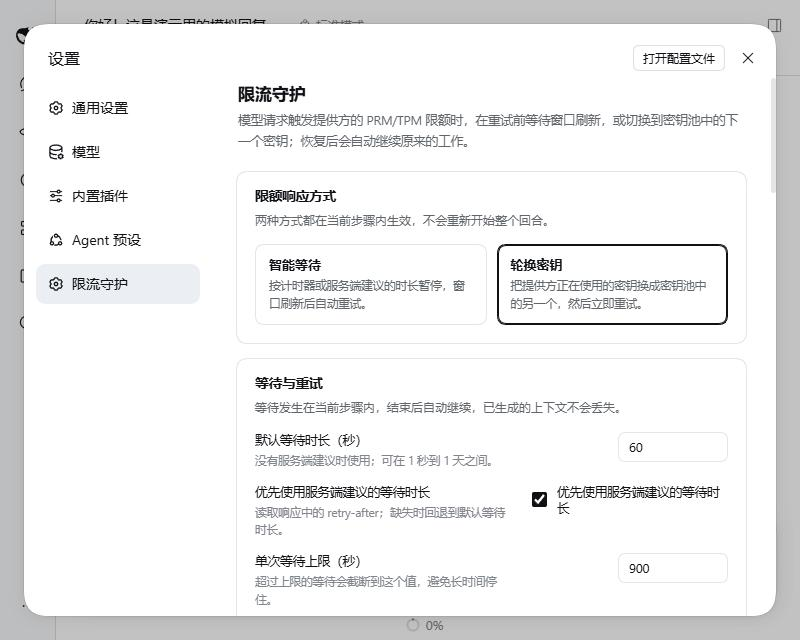
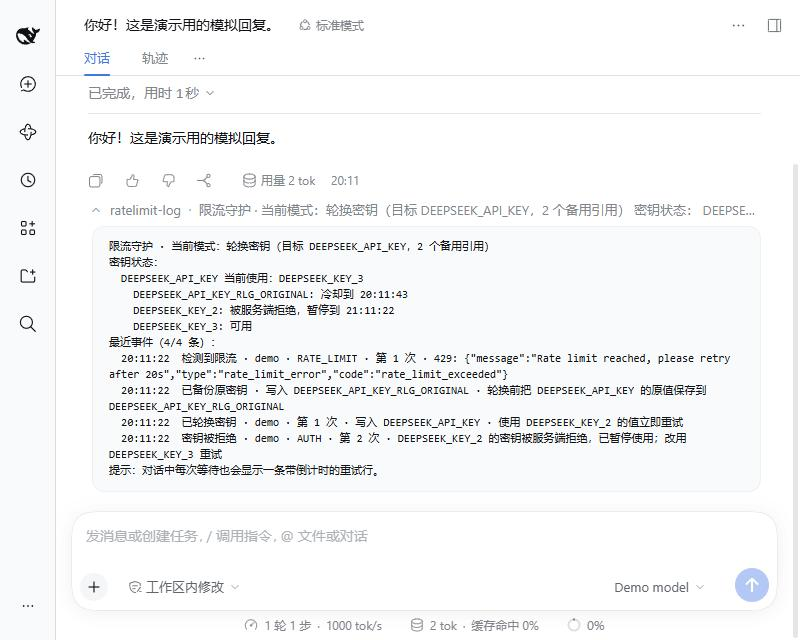

# dsh-rate-limit-guard（限流守护）

[](https://github.com/ChuQing-debug/dsh-rate-limit-guard/actions/workflows/test.yml)


[](LICENSE)

中文 | [English](README.en.md)

DeepSeek Harness（DSH）插件。模型请求被服务商限流（429）时，它让当前步骤**等待刷新后自动继续**，或者**换一个 API Key 立即继续**——任务不中断，上下文不丢。



## 为什么需要它

Agent 跑到一半遇到限流，DSH 默认重试几次后会把这一轮判为失败，你得手动重新发送，之前跑到的进度也只能重来。装上这个插件后：

- **等待模式**（默认）：按服务商给出的时长（`retry-after` 或报错文字里的提示）等待，没有提示就用你设定的时长，到点自动重试同一步骤。
- **轮换模式**：配置多个 Key，被限流时立刻换下一个继续；所有 Key 都在限流时，在单次等待上限内等最早恢复的那个，超过上限就交回 DSH。
- **余额/额度耗尽**（`QUOTA`、`ACCOUNT_QUOTA`）默认不空等：轮换模式换 Key，等待模式交回 DSH 报错。
- 每次等待和换 Key 都有记录：对话里的倒计时行、`/ratelimit-log`、插件日志三处可见。

## 功能一览

| 能力 | 说明 |
| --- | --- |
| 等待后自动继续 | 支持响应头、报错文字（中英文）、固定时长三种来源 |
| 多 Key 轮换 | 轮询使用，跳过冷却中的 Key；全部冷却时在单次等待上限内等最早恢复的 |
| 可视化目标选择 | 设置页按提供方分组列出**已配置**的 Key：可折叠、搜索，用来单选**目标密钥**；轮换池改为手动填写独立引用 |
| 原 Key 备份 | 轮换前把原 Key 存进 `<引用>_RLG_ORIGINAL`，不会悄悄覆盖你的 Key |
| 失效 Key 暂停 | 401 的 Key 暂停 1 小时；同一引用 10 分钟内最多暂停 2 个，防止服务商故障时误伤整池 |
| 等待预算 | 单次等待上限 + 每步骤累计等待上限，超限后交回 DSH 默认重试 |
| 无人值守续写 | 输出达到 token 上限时自动发送「继续」接着写，默认关闭；连续 20 次后自动停止 |
| 抖动 | 等待时长随机增加最多 10%（≤5 秒），避免多会话同时重试 |
| 可观测 | 对话倒计时行、`/ratelimit-log`、带时间戳的插件日志 |
| 中英双语 | 设置页跟随 DSH 语言；日志可用 `language` 固定 |

## 工作原理

```
agent/request-error  （限额失败，优先于 DSH 默认重试）
        │
        ├── 等待模式 ── 计算时长 → 写 llm/retry → 等待 → 写 llm/retry-started → { kind: 'retry' }
        │
        └── 轮换模式 ── 选下一个可用 Key → 写入凭据 → { kind: 'retry' }
```

- 监听器注册在 `agent/request-error` 上并 `prepend: true`，因此会先于内置重试策略拿到决定权；不处理时调用 `next()` 交还。
- 输出被 token 上限截断时走另一条路径：监听 `turn/end` 的 `max-tokens`，无人值守开启就自动发送 `continueText`，关闭时由输入框上方的提示条引导手动继续。
- 等待期间写入 DSH 已有的 `llm/retry` / `llm/retry-started` 会话事件，对话里的倒计时行就是它们渲染出来的，没有自定义事件类型。
- 重试只能沿用当前步骤的提供方与模型，所以插件换的是**同一提供方读取的凭据值**，而不是切换提供方。

更完整的设计与取舍见 [docs/DESIGN.md](docs/DESIGN.md)。

## 安装

要求：DSH 0.2.2-rc.3 或兼容版本（在桌面端验证）；无运行时依赖，不需要构建。

1. 把仓库放到一个固定目录。DSH 通常以链接方式安装这个目录，之后不要移动或删除；即使你的环境是复制安装，也建议保留仓库目录以便更新。

   ```bash
   git clone https://github.com/ChuQing-debug/dsh-rate-limit-guard.git
   ```

2. 在 DSH 中打开 **插件管理 → 安装 bundle**，选择这个目录。命令行环境也可以：

   ```bash
   dsh plugin --profile <profile 名> add <克隆目录的绝对路径>
   ```

   注意：桌面端的 `desktop` profile 由应用本身管理，命令行装不进去，只能在界面上安装。

3. 重启 DSH（桌面端重新打开；网页版刷新页面）。

装好后默认就是等待模式，不需要任何配置。

> 不要手动改 profile 里的 `cordis.patch.yml` 或 `package.json` 来安装插件，这两个文件由 DSH 管理。

## 使用

### 只用等待（默认）

无需配置。想调整的话打开 **设置 → 限流守护**：

- **默认等待时长**：服务商没给提示时等多久，默认 60 秒。
- **单次等待上限**：一次最多等多久，默认 900 秒。
- **每步骤累计等待上限**：一个步骤总共最多等多久，默认 60 分钟。

### 配置多 Key 自动轮换

1. 打开 **设置 → 限流守护**，模式选 **轮换密钥**。
2. **目标密钥**：选择器只列出桌面端**已经配好 Key** 的提供方，并按提供方分组；每组标题右侧显示 `已选/总数`。点分组标题展开或收起，点选项就把它设为目标（单选）。
3. **轮换池**：只接受**手动引用**，在下方输入框按行填写（例如自建的 `DEEPSEEK_KEY_2`）。轮换会把目标引用当前的值写进池中的槽位，所以池里必须是独立的存储引用；**其他提供方的 Key 引用**（如 `OPENROUTER_API_KEY`）由各自的提供方读取，填进来会被忽略，`/ratelimit-log` 会标出。已填引用显示为标签，点标签上的 × 可移除。
4. 某个提供方没有出现在选择器里，说明它还没配置 Key：先到 **设置 → 模型** 填好，再点 **刷新**。目标密钥也可以不用选择器，直接在手动输入框里填；手动内容优先。轮换池里的引用则只能手动填写。
5. 在下方的密钥列表里给每个引用粘贴 Key，点 **保存密钥**。
6. 不需要 API Key 的提供方由插件按提供方目录自动跳过；目录里没有的提供方，在 **按提供方映射** 里写一行 `提供方=-`（原因见[常见问题](#常见问题)）。
7. 点 **保存**。插拔提供方或改了 Key 后，点列表右上角的 **刷新** 即可重新读取，不用重开设置页。

设置页只保存引用名，Key 的值存在 DSH 的凭据服务里，保存后不会回显。

### 两种模式怎么选

| | 等待模式 | 轮换模式 |
| --- | --- | --- |
| 适合 | 只有一个 Key，或限流窗口很短 | 有多个 Key，希望立刻继续 |
| 被限流时 | 等待后重试 | 换下一个 Key 立即重试 |
| 所有 Key 都被限流 | 不适用 | 在单次等待上限内等最早恢复的；超限交回 DSH |
| 余额/额度耗尽 | 交回 DSH 报错 | 换下一个 Key |
| 需要配置 | 不需要 | 需要填密钥池 |



## 配置项

所有配置都能在设置页修改（`minWaitSeconds` 除外），保存后立即生效，不用重启。

### 等待

| 配置 | 默认 | 说明 |
| --- | --- | --- |
| `mode` | `wait` | `wait` 等待，`rotate` 轮换 |
| `waitSeconds` | `60` | 服务商没给提示时的等待秒数 |
| `useRetryAfter` | `true` | 优先使用服务商建议的时长 |
| `maxWaitSeconds` | `900` | 单次等待上限 |
| `maxAttempts` | `12` | 每个步骤最多重试几次 |
| `maxTotalWaitMinutes` | `60` | 每步骤累计等待上限，`0` 表示不限制 |
| `jitter` | `true` | 等待时长随机增加最多 10%（≤5 秒） |
| `waitOnQuota` | `false` | 余额/额度耗尽时是否也等待 |
| `minWaitSeconds` | `1` | 等待与冷却的下限，只能改配置文件 |

等待时长按 **`retry-after` → 报错文字提示 → `waitSeconds`** 的顺序取值，再夹在 `minWaitSeconds` 与 `maxWaitSeconds` 之间。报错文字支持中英文，例如 `retry after 30s`、`try again in 1m30s`、`请在 30 秒后重试`、`until 2026-11-18T11:11:52Z (~9s`。

达到 `maxAttempts` 或 `maxTotalWaitMinutes` 后，失败会交回 DSH 的默认重试策略，它可能还会自己再试几次。

轮换模式下等冷却池恢复也受 `maxWaitSeconds` 限制：最早恢复时间超过上限时不再空等，直接交回 DSH；等待结束仍没有可用 Key 时，也不会继续用冷却中的 Key 重试。

### 轮换

| 配置 | 默认 | 说明 |
| --- | --- | --- |
| `credentialRef` | `DEEPSEEK_API_KEY` | 提供方读取的引用，轮换时写入它 |
| `alternateKeyRefs` | `[]` | 轮换池引用列表（独立存储槽，手动填写）；提供方自己的 Key 引用会被忽略 |
| `providerRefs` | `[]` | 选填：每行 `提供方=引用`；不写则按提供方目录里的 `apiKeyEnv` 自动识别；`提供方=-` 表示该提供方不轮换 |
| `keepOriginalKey` | `true` | 换走原 Key 前先备份 |
| `quotaCooldownMinutes` | `60` | 额度耗尽的 Key 多久内不再使用 |
| `fallbackToWait` | `true` | 没有可用 Key 时改为等待 |

### 其他

| 配置 | 默认 | 说明 |
| --- | --- | --- |
| `guardedProviders` | `[]` | 只对列出的提供方生效，留空表示全部 |
| `language` | `auto` | `/ratelimit-log` 与日志备注语言：`auto`、`zh`、`en` |

引用名只能包含字母、数字和下划线，且不能以数字开头。

### 无人值守

| 配置 | 默认 | 说明 |
| --- | --- | --- |
| `unattended` | `false` | 输出达到 token 上限被截断时，自动发送下一条消息 |
| `continueText` | `继续` | 自动发送的内容 |

开启后，每次因输出 token 上限结束（`turn/end`，`reason.kind` 为 `max-tokens`）时，插件会向同一会话自动发送 `continueText`，模型接着写下去。连续自动继续最多 20 次；只要出现一次不是因截断结束的回合，或距离上次超过 30 分钟，计数就会重置，避免在异常情况下无限循环，停止时会写一条日志。

关闭时，DSH 自带的“已达到输出 token 上限”提示仍然出现；此外输入框上方会多出一条提示条，点“填入继续”会把 `continueText` 放进输入框并聚焦，按回车即可继续，也可以直接关闭提示条。

## 查看记录

在对话里输入 `/ratelimit-log`。轮换模式下会先列出每个 Key 的状态（池内持有、可用、冷却、失效），然后是最近 20 条事件：



只显示引用名和时间，不会显示 Key 的值。插件日志里也有同样的记录：

```
rate-limit-guard waiting at=03:14:22 provider=shusheng code=HTTP_429 mode=wait retry=1 delay=30s key=DEEPSEEK_KEY_2 resumeAt=03:14:52
rate-limit-guard auto-continue at=03:15:07 provider=shusheng code= mode= retry=2 delay=0s note=输出被 token 上限截断，已自动发送“继续”
```

## 密钥安全

轮换会改写目标引用里的 Key，所以插件遵守一条规则：**不会覆盖一个没有在别处保存的 Key。**

- **原 Key 会先备份。** 第一次换走你自己的 Key 时，它被保存到 `<目标引用>_RLG_ORIGINAL`，之后继续参与轮换。
- **后来手动换的 Key 也会备份**，保存到 `<目标引用>_RLG_PREVIOUS`。
- **备份不会被覆盖。** 两个备份位置都占用时，插件拒绝轮换，改为等待并记录原因。把新 Key 加进备用密钥，或清掉一个备份，即可恢复。
- **读不出来就不动。** 目标引用或备份读取失败、或轮换过程中目标引用被改，这次轮换会放弃。
- **失效 Key 会被跳过。** 刚换上的 Key 被 401 拒绝时暂停 1 小时并换下一个；同一引用 10 分钟内最多暂停 2 个，再多就停止并换回原 Key，避免服务商临时故障时把整池 Key 都禁掉。
- **状态只在内存里。** 冷却和暂停只记录 Key 的指纹，不保存 Key 本身，重启后清空。
- **选择器只读状态，不读值。** 设置页通过官方凭据服务拿到的只有「是否已配置」和掩码，不会显示 Key 的内容；保存密钥也走凭据服务，保存后不回显。

想恢复原 Key：它在 `<目标引用>_RLG_ORIGINAL` 里并自动参与轮换；也可以在设置页把它重新填回目标引用。关闭 `keepOriginalKey` 后不再备份，轮换会直接覆盖目标引用。

## 已知限制

- **不能跨提供方切换。** DSH 的重试只能沿用当前步骤的提供方和模型，插件换的是该提供方读取的 Key。
- **不在提供方目录里的提供方要手动映射。** 插件通过官方提供方目录与设置表单识别每个提供方读取的引用；目录里没有的提供方（以及需要显式排除的）要在映射里写 `提供方=-` 或 `提供方=引用`。
- **部分适配器不传 `Retry-After` 头。** 在 DSH 0.2.2-rc.3 上，`openai-completions` 类提供方拿不到这个响应头，这时只能靠报错文字里的提示，否则使用默认等待时长。
- **没启用凭据服务的 profile 不能轮换。** 如果 profile 没有加载 `credentials` 服务，插件读不到也改不了 Key，轮换会自动改为等待并记录原因。
- **设置页不显示实时状态。** DSH 不允许第三方插件给自己的设置页传运行状态，实时状态请用 `/ratelimit-log` 查看。
- **轮换是全局的。** 目标引用由所有会话共用，一次轮换影响所有读取它的会话。
- **冷却按 Key 记录，不分模型。** 一个 Key 在某个模型上被限流后，换到别的模型也会被暂时跳过。
- **自动继续只在 `max-tokens` 时触发。** 提供方如果以别的结束原因返回截断，插件不会介入；连续 20 次后也会停止，需要手动检查。

## 常见问题

| 现象 | 检查 |
| --- | --- |
| 设置页提示找不到配置 | 插件是否已在当前 profile 启用；重启 DSH 再打开设置 |
| 没有等待，直接失败了 | 报错是否属于限流（`RATE_LIMIT`、429）；是否属于默认不等待的额度耗尽；`guardedProviders` 是否漏了当前提供方 |
| 没有换 Key | 轮换池里是否填了至少一个**独立引用**（不是其他提供方的 Key 引用）、它是否已填值；提供方是否被标记为 `-`；`/ratelimit-log` 里各 Key 是否都在冷却 |
| 日志说“两个备份引用都已占用” | 见[密钥安全](#密钥安全)：把新 Key 加进轮换池，或清掉一个备份 |
| `/ratelimit-log` 提示未知命令 | 插件的主机端没有加载，重新安装或启用 bundle |
| 保存失败 | 配置文档只读，或被别处同时修改；点“重新读取”后再保存 |
| 密钥选择器是空的 | 桌面端还没有任何提供方配置好 Key；先到 **设置 → 模型** 填一个，再点 **刷新**。也可以在手动输入框里直接填引用名 |
| 选择器里少了某个提供方 | 它还没配置 Key（插件只列出已配置的提供方）；配置后点 **刷新** |
| 填了 `OPENROUTER_API_KEY` 之类的提供方引用，轮换池里没有生效 | 池里只能填独立存储引用；其他提供方的 Key 引用会被忽略，`/ratelimit-log` 会显示“已忽略”。目标密钥请用上方单选选择器或手动目标输入框设置 |
| 所有 Key 都在冷却，等了一会儿还是失败 | 最早恢复时间可能超过 `maxWaitSeconds`，插件会交回 DSH 而不是继续用冷却中的 Key；可调大 `maxWaitSeconds` 或 `maxTotalWaitMinutes` |

**为什么不需要 Key 的提供方要写 `提供方=-`？**
不写的话，这个提供方被限流时插件会去轮换默认引用——对它没有任何帮助，还会让池里的 Key 被白白标记为冷却。

## 开发

没有构建步骤，也没有运行时依赖。

```bash
npm run check   # 语法检查
npm test        # 全部测试（node:test），当前 85 项
```

- 测试覆盖等待时长解析、离线/中止、备份与轮换、冷却、并发轮换、密钥选择器、提供方目录解析、日志输出等。
- CI：Node 22 / 24，见 [.github/workflows/test.yml](.github/workflows/test.yml)。
- 设计文档 [docs/DESIGN.md](docs/DESIGN.md)，版本记录 [中文](CHANGELOG.md) / [English](CHANGELOG.en.md)，应用内说明 [docs/DETAIL.md](docs/DETAIL.md)。

## 目录结构

```
dsh-rate-limit-guard/
├── README.md           # 中文说明（GitHub 首页）
├── README.en.md        # English README
├── CHANGELOG.md        # 版本记录（中文）
├── CHANGELOG.en.md     # 版本记录（English）
├── LICENSE             # MIT
├── SECURITY.md         # 漏洞报告方式
├── index.js            # 主机端插件：监听限额失败、等待、轮换、命令注册
├── lib.js              # 纯函数：失败分类、时长解析、引用选择、指纹
├── client.js           # 设置页与输入框提示条（React，无构建）
├── cordis.patch.yml    # bundle 补丁：向 profile 插入条目
├── locale/             # 中英文界面文案
├── docs/               # 设计、使用说明、截图
├── vendor/             # schemastery / cosmokit（MIT，见 NOTICE）
├── test/               # node:test 测试
├── .github/workflows/  # CI（Node 22 / 24）
├── .gitignore
└── icon.svg
```

## 许可证

[MIT](LICENSE)。`vendor/` 下的 `schemastery` 与 `cosmokit` 同为 MIT，声明见 [vendor/NOTICE.md](vendor/NOTICE.md)。

安全问题请不要公开提交 issue，按 [SECURITY.md](SECURITY.md) 的方式私下报告。
