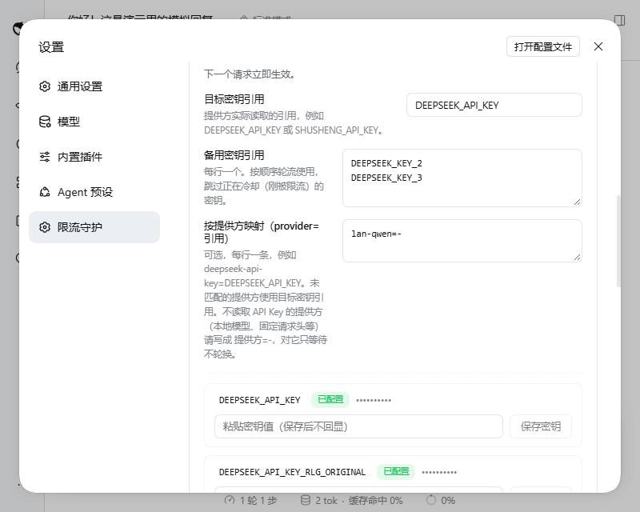

# dsh-rate-limit-guard（限流守护）

[](https://github.com/ChuQing-debug/dsh-rate-limit-guard/actions/workflows/test.yml)


[](LICENSE)

中文 | [English](README.en.md)

DeepSeek Harness（DSH）的插件。模型请求被服务商限流（429）时，它让当前步骤**自动等待后继续**，或者**自动换一个 API Key 继续**，任务不会中断，上下文不会丢。


## 它解决什么问题

Agent 跑到一半遇到限流，DSH 默认重试几次后就报"本轮运行失败"，你得手动重新发送。装上这个插件后：

- **等待模式**（默认）：按服务商提示的时长等待，没有提示就用你设定的时长，到点自动重试同一步骤。
- **轮换模式**：你有多个 Key 时，立刻换下一个 Key 重试；所有 Key 都被限流时，等最早恢复的那个。
- 余额或额度耗尽（402）时不会白等：轮换模式换 Key，等待模式直接报错。
- 每次等待和换 Key 都有记录，在对话里输入 `/ratelimit-log` 就能看到。

## 快速上手

### 安装

1. 把仓库克隆到一个固定位置。DSH 是链接到这个目录的，之后不要移动或删除它。

   ```bash
   git clone https://github.com/ChuQing-debug/dsh-rate-limit-guard.git
   ```

2. 在 DSH 里打开 **插件管理 → 安装 bundle**，选择克隆下来的目录。用命令行也可以：

   ```bash
   dsh plugin --profile <profile 名> add <克隆目录的绝对路径>
   ```

3. 重启 DSH（网页版刷新页面）。

装好后默认就是等待模式，不需要任何配置。

> 不要手动编辑 profile 里的 `cordis.patch.yml` 或 `package.json` 来安装插件，这两个文件由 DSH 管理。

### 只想等待（默认）

不用设置。想调整的话，打开 **设置 → 限流守护**：

- **默认等待时长**：服务商没给提示时等多久，默认 60 秒。
- **单次等待上限**：一次最多等多久，默认 900 秒。
- **每步骤累计等待上限**：一个步骤总共最多等多久，默认 60 分钟。

### 有多个 Key，想自动轮换

1. 打开 **设置 → 限流守护**，选择 **轮换密钥**。
2. **目标密钥引用** 填提供方实际读取的那个引用名，也就是提供方配置里的 `apiKeyEnv`，例如 `DEEPSEEK_API_KEY`。
3. **备用密钥引用** 每行填一个引用名，例如 `DEEPSEEK_KEY_2`、`DEEPSEEK_KEY_3`。
4. 在下方的密钥列表里，给每个备用引用粘贴 Key 的值，点 **保存密钥**。
5. 如果你还在用**不需要 API Key 的提供方**（本地模型、用固定请求头认证的接口），在 **按提供方映射** 里给它写一行 `提供方名=-`。原因见[常见问题](#常见问题)。
6. 点 **保存**。



设置页只保存引用名，Key 的值存在 DSH 的凭据服务里，保存后不会回显。

## 两种模式怎么选

| | 等待模式 | 轮换模式 |
| --- | --- | --- |
| 适合 | 只有一个 Key，或限流窗口很短 | 有多个 Key，希望立刻继续 |
| 被限流时 | 等待后重试 | 换下一个 Key 立即重试 |
| 所有 Key 都被限流 | 不适用 | 等最早恢复的那个 |
| 余额/额度耗尽 | 直接交回 DSH 报错 | 换下一个 Key |
| 需要配置 | 不需要 | 需要填密钥池 |


## 查看记录

在对话里输入 `/ratelimit-log`。轮换模式下会先列出每个 Key 的状态，然后是最近 20 条事件：


只显示引用名和时间，不会显示 Key 的值。插件日志里也有同样的记录，前缀是 `rate-limit-guard`。

## 配置项

所有配置都能在设置页修改（`minWaitSeconds` 除外），保存后立即生效，不用重启。

### 等待

| 配置 | 默认 | 说明 |
| --- | --- | --- |
| `mode` | `wait` | `wait` 等待，`rotate` 轮换 |
| `waitSeconds` | `60` | 服务商没给提示时的等待秒数 |
| `useRetryAfter` | `true` | 优先用服务商给的等待时长 |
| `maxWaitSeconds` | `900` | 单次等待的上限 |
| `maxAttempts` | `12` | 每个步骤最多重试几次 |
| `maxTotalWaitMinutes` | `60` | 每个步骤累计最多等多久，`0` 表示不限制 |
| `jitter` | `true` | 等待时长随机增加最多 10%（不超过 5 秒） |
| `waitOnQuota` | `false` | 余额/额度耗尽时是否也等待 |

- **等待时长的来源**依次是：服务商返回的 `retry-after`、报错文字里的提示、`waitSeconds`。报错文字支持中英文，例如 `retry after 30s`、`try again in 1m30s`、`请在 30 秒后重试`、`until 2026-11-18T11:11:52Z (~9s`。
- **达到上限后**（`maxAttempts` 或 `maxTotalWaitMinutes`），失败会交回 DSH 的默认重试策略。它可能还会自己再试几次。

### 轮换

| 配置 | 默认 | 说明 |
| --- | --- | --- |
| `credentialRef` | `DEEPSEEK_API_KEY` | 提供方读取的密钥引用，轮换时写入它 |
| `alternateKeyRefs` | `[]` | 备用密钥的引用名 |
| `providerRefs` | `[]` | 每行 `提供方=引用`；`提供方=-` 表示该提供方不轮换 |
| `keepOriginalKey` | `true` | 换走原密钥前先备份 |
| `quotaCooldownMinutes` | `60` | 额度耗尽的 Key 多久内不再使用 |
| `fallbackToWait` | `true` | 没有可用 Key 时改为等待 |

### 其他

| 配置 | 默认 | 说明 |
| --- | --- | --- |
| `guardedProviders` | `[]` | 只对列出的提供方生效，留空表示全部 |
| `language` | `auto` | 日志和 `/ratelimit-log` 的语言：`auto`、`zh`、`en` |
| `minWaitSeconds` | `1` | 等待和冷却的下限，只能在配置文件里改 |

引用名只能包含字母、数字和下划线，不能以数字开头。

## 密钥安全

轮换会改写目标引用里的 Key，所以插件遵守一条规则：**不会覆盖一个没有在别处保存的 Key。**

- **原密钥会先备份。** 第一次换走你自己的 Key 时，它被保存到 `<目标引用>_RLG_ORIGINAL`，之后继续参与轮换。
- **后来手动换的 Key 也会备份。** 如果你之后又在目标引用里填了一个新 Key，它会被保存到 `<目标引用>_RLG_PREVIOUS`。
- **备份不会被覆盖。** 两个备份位置都占用时，插件拒绝轮换，改为等待，并在日志里说明原因。把新 Key 加进备用密钥，或者清掉一个备份，就能恢复轮换。
- **读不出来就不动。** 目标引用或备份读取失败、或者轮换过程中目标引用被改了，这次轮换都会放弃。
- **失效的 Key 会被跳过。** 刚换上的 Key 如果被服务商拒绝（401），它会被暂停 1 小时并换下一个。同一个引用 10 分钟内最多这样暂停 2 个，再多就停止并换回原密钥，避免服务商临时故障时把所有 Key 都暂停。
- **状态只在内存里。** 冷却和暂停记录只保存 Key 的指纹，不保存 Key 本身，重启 DSH 后清空。

想恢复原密钥：它在 `<目标引用>_RLG_ORIGINAL` 里，会自动参与轮换；也可以在设置页把它的值重新填回目标引用。

关闭 `keepOriginalKey` 后不再备份，轮换会直接覆盖目标引用。

## 已知限制

- **不能跨提供方切换。** DSH 的重试只能沿用当前步骤的提供方和模型，插件换的是这个提供方读取的 Key。
- **不需要 Key 的提供方要手动标记。** DSH 没有告诉插件每个提供方读哪个引用，所以只有 `deepseek-account` 能自动识别，其他的要在映射里写 `提供方=-`。
- **服务商的 `Retry-After` 响应头可能拿不到。** 在 DSH 0.2.2-rc.3 上，`openai-completions` 类提供方的这个响应头没有传给插件，这时只能靠报错文字里的提示，否则走默认等待时长。
- **无界面模式默认不能轮换。** `headless` profile 默认没启用凭据服务，轮换会自动改为等待。在 profile 里启用 `credentials` 后可用。
- **设置页不显示实时状态。** DSH 不允许第三方插件把运行状态传给自己的设置页，状态请用 `/ratelimit-log` 查看。
- **轮换是全局的。** 目标引用是所有会话共用的，一次轮换会影响所有读取它的会话。
- **冷却按 Key 记录，不分模型。** 一个 Key 在某个模型上被限流后，换到别的模型时也会被暂时跳过。

## 常见问题

| 现象 | 检查 |
| --- | --- |
| 设置页提示找不到配置 | 插件是否已在当前 profile 启用；重启 DSH 再打开设置 |
| 没有等待，直接失败了 | 报错是否属于限流（`RATE_LIMIT`、429）；余额耗尽默认不等待；`guardedProviders` 是否漏了当前提供方 |
| 没有换 Key | 备用引用是否都已填值；提供方是否被标记为 `-`；`/ratelimit-log` 里各 Key 是否都在冷却 |
| 日志说"两个备份引用都已占用" | 见[密钥安全](#密钥安全)：把新 Key 加进备用密钥，或清掉一个备份 |
| `/ratelimit-log` 提示未知命令 | 插件的主机端没有加载，重新安装或启用 bundle |
| 保存失败 | 配置文档只读，或被别处同时修改；点"重新读取"后再保存 |

**为什么不需要 Key 的提供方要写 `提供方=-`？**
不写的话，这个提供方被限流时，插件会去轮换默认的密钥引用。这对它没有任何帮助，还会让密钥池里的 Key 被白白标记为冷却。

## 开发

没有构建步骤，也没有运行时依赖。

```bash
npm run check   # 语法检查
npm test        # 全部测试，基于 node:test，无依赖
```

- 工作原理和设计取舍见 [docs/DESIGN.md](docs/DESIGN.md)。
- 版本变化见 [CHANGELOG.md](CHANGELOG.md)。
- 应用内的说明文档是 [docs/DETAIL.md](docs/DETAIL.md)。

## 许可证

[MIT](LICENSE)。`vendor/` 下的 `schemastery` 和 `cosmokit` 同为 MIT 许可，声明见 [vendor/NOTICE.md](vendor/NOTICE.md)。
